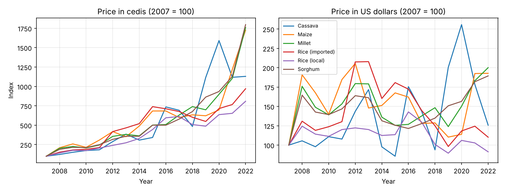
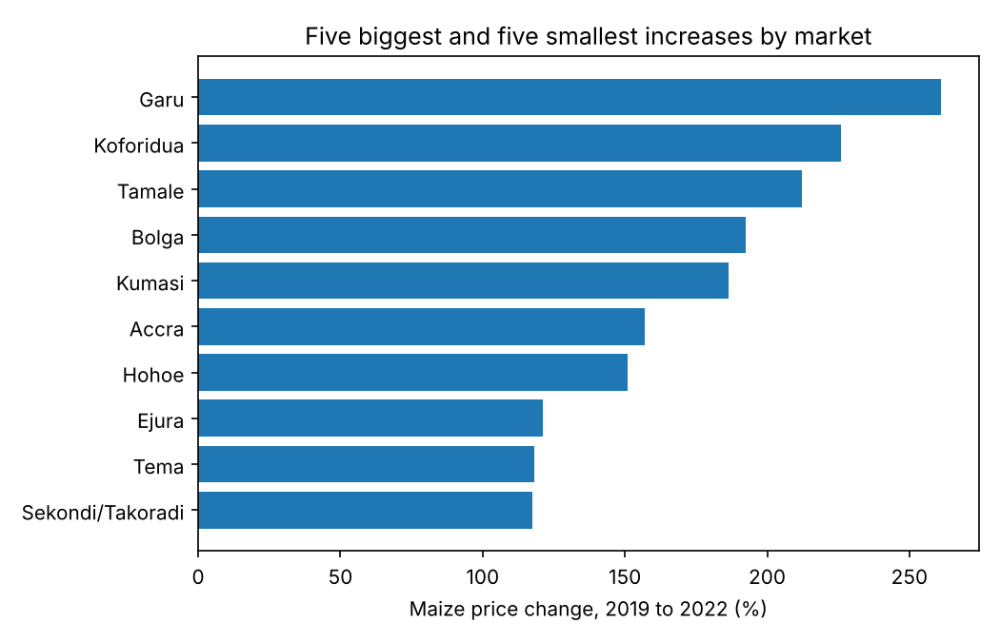

# Ghana Staple Food Prices, 2006 to 2023

## Question
Which staple foods rose fastest in price, and in which markets?

## Data
WFP Food Prices for Ghana, from the Humanitarian Data Exchange. The file has 37,263 rows from January 2006 to July 2023.

## Method
1. Kept wholesale prices. Wholesale prices use sack sizes (50 KG, 100 KG and so on). Retail prices use KG. Mixing them gives wrong trends.
2. Converted every price to price per KG, in cedis and in US dollars.
3. Kept six staples with data from 2006 to 2023: maize, millet, sorghum, cassava, imported rice and local rice.
4. Took the yearly median across markets and compared 2007 with 2022. 2023 holds data to July only.
5. Ranked markets by maize price change from 2019 to 2022.

## Findings
- In cedis, maize, millet and sorghum rose about 1,600% to 1,700% from 2007 to 2022. In US dollars the rise was 89% to 100%. Most of the cedi increase comes from the falling value of the cedi.
- From 2019 to 2022, maize rose 178% in cedis and 75% in dollars. Local rice rose 66% in cedis and 2% in dollars. Cassava stayed flat in cedis.
- Maize prices rose most in Garu (261%), Koforidua (226%), Tamale (212%), Bolga (193%) and Kumasi (187%). They rose least in Sekondi/Takoradi (117%), Tema (118%) and Ejura (121%).

## Limits
The number of markets reporting grew in 2019, so early and late medians do not cover the same markets. Read small differences with care.

## Files
- ghana_food_prices.ipynb: full analysis
- wfp_food_prices_gha.csv: data
- charts/: saved charts

## Tools
Python, pandas, matplotlib
